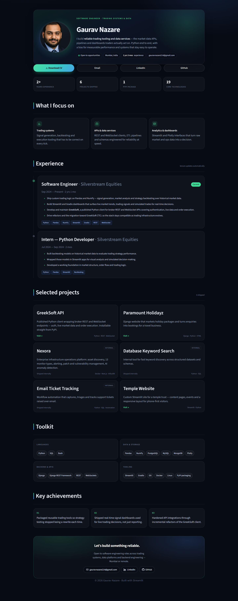

# Gaurav Nazare — Digital CV

A single-page professional profile built with Streamlit, styled with a hand-written
design system (no component libraries), and structured so the content can be updated
without touching layout code.

**Live:** https://gauravnazare.streamlit.app/



---

## Why this exists

The previous version was a working CV, but it was built from stacked Streamlit
primitives: two hero columns, a flat skills dump, `st.write("---")` dividers and a
`st.caption("Profile photo")` under the portrait. On a phone the hero alone ran to
~1,600px and social links drifted apart on the grid.

This rewrite keeps Streamlit as the host — so deployment stays one-click — and takes
over the presentation layer with a CSS grid system:

| Area | Before | Now |
| --- | --- | --- |
| Layout | `st.columns` everywhere | CSS grid, single-column semantic sections |
| Hero | Photo, caption, title, text, links in 2 columns | One card: portrait, role, pitch, live chips |
| Mobile | Stacked, ~6.3k px, dead space | Grid collapses at 900 / 640 / 460 px, 2×2 CTAs |
| Skills | 12 pills in 4 columns | 4 grouped cards |
| Projects | `**name**` + paragraph | 2-up cards with stack + link affordance |
| Theming | Streamlit default | Dark editorial theme pinned in `config.toml` |
| Tenure | Hand-counted strings | Derived from `start` dates, never stale |
| Print | Unusable | `@media print` stylesheet for a clean PDF |

It also removes a bug: the old `Gaurav_N_Digital_CV.py` called `st.experimental_rerun()` every 60s.
That alias was renamed to `st.rerun()` and is gone from current Streamlit releases, so
any session open for a minute would raise `AttributeError`. It also did nothing to
prevent sleep — see [Keeping the app awake](#keeping-the-app-awake).

---

## Features

- **Design system in `main.css`** — tokens, grid, components, responsive rules, print rules. ~900 lines, zero dependencies.
- **Content/data separation** — all copy lives in `content.py`; `Gaurav_N_Digital_CV.py` only renders.
- **Derived metadata** — tenure badges, "years experience" and "core technologies" counts are computed, so they cannot drift from reality.
- **Graceful degradation** — missing photo falls back to a generated initials avatar; missing CV swaps the download button for a "Request CV" mailto.
- **No runtime image dependency** — Streamlit 1.47 pins `pillow<12` while the platform runs Python 3.14, so the avatar is pre-rendered instead of processed at boot.
- **Accessibility** — semantic `<header>`/`<section>`/`<article>`, `alt` text, visible focus rings from the theme, 44px+ tap targets, `prefers-reduced-motion` honoured.
- **Performance** — portrait inlined as a ~13KB JPEG data URI (no extra request, no layout shift); no image library at runtime.
- **Tested helpers** — `pytest` suite covering tenure maths and content integrity.

---

## Project structure

```
.
├── Gaurav_N_Digital_CV.py      # page composition + HTML builders
├── content.py                 # ALL copy, dates, projects, skills
├── main.css                   # design system
├── .streamlit/
│   └── config.toml            # dark theme, toolbar hidden, XSRF/CORS on
├── .github/workflows/
│   └── keep-alive.yml         # 10-minute warm-up ping
├── assets/profile-360.jpg     # portrait: pre-cropped, pre-sized (~13KB)
├── tools/make_avatar.py       # regenerates the crop (dev-only, needs Pillow)
├── tests/
│   ├── conftest.py
│   ├── test_app.py            # renders the page headless (Streamlit AppTest)
│   └── test_content.py        # tenure maths + content integrity
├── requirements.txt           # pinned
└── docs/                      # render screenshots used by this README
```

> `CV.pdf` is **not** included here — your existing resume stays at the repo root and
> the download button picks it up automatically. If it is missing, the button degrades
> to a "Request CV" mail link instead of breaking.

---

## Run locally

```bash
python -m venv .venv
# Windows
.venv\Scripts\activate
# macOS / Linux
source .venv/bin/activate

pip install -r requirements.txt
streamlit run Gaurav_N_Digital_CV.py
```

Opens on <http://localhost:8501>.

> The app also runs without `CV.pdf` or a portrait — it degrades rather than crashing,
> so you can preview a redesign before the assets are in place.

---

## Updating content

Everything user-facing is in `content.py`.

**Add a project** — append to `PROJECTS`:

```python
{
    "name": "Aegis",
    "desc": "One or two lines on the problem and what you built.",
    "metric": "700+ devices · ~500 users",   # the number a reader should remember
    "stack": "FastAPI · Next.js · TimescaleDB",
    "url": "https://example.com",            # None for internal work
    "flag": None,                            # "Internal" shows a badge instead of a link
},
```

**Add a role** — append to `EXPERIENCE` (newest first). Tenure badges, the
"years experience" stat and date ranges are all derived from `start` / `end`:

```python
{
    "role": "Senior Software Engineer",
    "company": "Company",
    "location": "Mumbai",
    "start": date(2026, 1, 1),
    "end": None,                    # None = current
    "current": True,
    "bullets": ["Outcome-led bullet with a number in it."],
    "tags": ["Python", "Kafka"],
},
```

The test suite asserts content rules (only one current role, reverse-chronological
order, public projects have HTTPS links) so a malformed edit fails CI instead of the page.

---

## Deploy (Streamlit Community Cloud)

1. Push this folder to a GitHub repo.
2. <https://share.streamlit.io> → **New app** → pick repo, branch, `Gaurav_N_Digital_CV.py`.
3. Confirm `CV.pdf` and the portrait are committed (`.gitignore` does not exclude them).
4. **Settings → Sharing** → make sure the app is **public**. A private app redirects
   recruiters to a `share.streamlit.io` login wall — the fastest way to lose a lead.

Config in `.streamlit/config.toml` pins the dark theme and hides the deploy toolbar, so
the page looks the same regardless of the visitor's OS theme.

---

## Keeping the app awake

Community Cloud suspends an app after a stretch without traffic. The next visitor then
pays a 30–60s cold start — unacceptable when the link is on a résumé.

There is no server-side "always on" switch on the free tier, and no amount of in-app
code can fix it: once the container stops, nothing of yours is running to wake it. The
wake-up has to come from outside.

**Included: `.github/workflows/keep-alive.yml`** — pings the app every 10 minutes
(cron `*/10 * * * *`), with `workflow_dispatch` for manual runs.

Caveats worth knowing:

- GitHub delays scheduled jobs by a few minutes under load; 10-minute cadence absorbs that.
- Scheduled workflows are disabled after **60 days without repo activity** — commit
  something (or run the job manually) roughly quarterly.
- Each run is ~20s of a GitHub-hosted runner; comfortably inside the free allowance for
  public repos.

**Alternative: [UptimeRobot](https://uptimerobot.com)** (free, 5-minute checks) does the
same job without touching GitHub, and alerts you if the app actually goes down. Pick one;
running both is redundant.

**If you outgrow Community Cloud**, the same code runs unchanged on Hugging Face Spaces
(Streamlit SDK), Render, or Fly.io — where you control the idle policy and can keep a
warm instance without a pinger.

---

## Quality gates

```bash
python -m pytest -q        # tenure maths + content integrity
python -m ruff check .     # lint (config in pyproject.toml)
```

---

## Notes on the design

- **One accent, two tints.** Mint `#3DDC97` for primary/action, indigo `#4F8CFF` for
  secondary depth. Everything else is a neutral on `#070B14`.
- **Hierarchy through weight and spacing**, not colour — headings are 600–700 weight with
  tight tracking; body copy is muted so the name and role dominate.
- **Cards are a fallback, not the layout.** Sections are separated by rules and rhythm;
  the card border only appears where a real object exists (a job, a project, a metric).
- **Motion is minimal**: 2px lift on hover, one pulsing dot for availability. All of it is
  disabled under `prefers-reduced-motion`.
